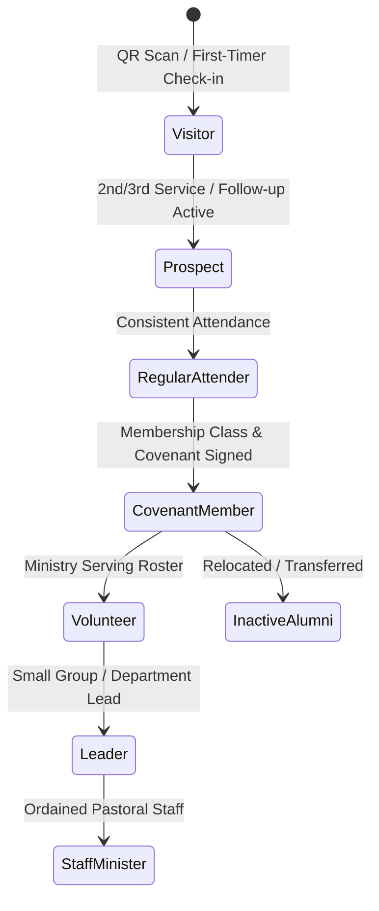

# EVOLVE CHURCH MANAGEMENT SYSTEM (Evolve ChMS)
## Comprehensive Product, Technical & Architectural Specification Document

---

## 1. Executive Summary & Competitive Research

### 1.1 The Market Opportunity
The global Church Management Software (ChMS) market is characterized by aging legacy platforms, fragmented modular subscriptions, and outdated user experiences. Churches today operate as complex, multi-faceted organizations encompassing spiritual care, multi-campus operations, event logistics, volunteer coordination, compliance, and multi-million dollar non-profit fund accounting.

### 1.2 Competitive Benchmark & Gap Analysis

| Platform | Core Strengths | Critical Pain Points & Gaps | How Evolve ChMS Wins |
| :--- | :--- | :--- | :--- |
| **Planning Center (PCO)** | Gold standard for volunteer scheduling & service orders (`Services`); decent check-ins. | Fragmented modular pricing (pay per app); no built-in double-entry fund accounting; weak CRM lead/visitor pipeline; no visual organigram. | **Unified all-in-one suite** with modern integrated fund accounting, visual drag-and-drop organigram, and zero nickel-and-diming per module. |
| **Pushpay / CCB** | Strong enterprise donor management and multi-campus giving. | Extremely high enterprise price tag; rigid legacy UI; slow performance; steep onboarding curve. | **Blazingly fast Next.js + ElysiaJS architecture**; instant optimistic updates; accessible modern pricing and modern CRM Kanban pipelines. |
| **Breeze ChMS** | Simple interface; flat $72/month pricing; great for small churches. | Severely lacks advanced features: no true multi-fund accounting, no multi-tier organigram, no advanced custom pipelines. | **Maintains Breeze's simplicity** for daily volunteers while offering enterprise multi-campus power, deep accounting, and advanced pipelines. |
| **Tithe.ly** | Strong mobile giving and digital check-ins. | Weak project management; limited multi-branch pastoral hierarchy; rudimentary reporting. | **Comprehensive Kanban project management** and automated drip sequences directly integrated with member and pastoral records. |
| **Rock RMS** | Highly customizable; open-source core; robust data modeling. | Heavy .NET legacy stack; requires dedicated IT engineers; poor default UI/UX; painful upgrades. | **Modern TypeScript full-stack (Next.js 16 + Drizzle ORM + ElysiaJS)** with turnkey cloud deployments and modern design aesthetics. |

### 1.3 Design Benchmark & Aesthetics (Reference Screenshots)
Based on the approved design language:
- **Canvas & Tone**: Pristine white surfaces (`#ffffff`) over subtle warm/neutral canvas (`#f8faf9`), with generous spacing, soft rounded corners (`rounded-xl` / `rounded-2xl`), and thin borders (`border-zinc-200/70`).
- **Accent Identity**: Distinctive fresh green (`#16a34a` / `#22c55e`) used with restraint for primary actions, active navigation pills, stage highlights, and financial totals.
- **Kanban Board Aesthetics**:
  - Column headers with stage title, aggregate monetary sum (`$6,500.00`), total card count (`8 deals`), and action menus.
  - Cards containing entity title, location, primary contact with colored avatar initials, pledge/financial amount, elapsed time indicator (`1m`, `30m`, `5h`), and task/note/attachment counter badges.
  - Slide-over detail drawer with stage pipeline progress breadcrumb (`New Leads -> Request Rec... -> In Draft -> Proposal Sent -> Approved`), sequence automation triggers, tabbed navigation (`Activity`, `Appointments`, `Proposals/Giving`, `Invoices`, `Notes`, `Tasks`), and contact metadata.
- **Sidebar (sidebar-07)**:
  - Collapsible hierarchical navigation, Church/Campus switcher at the top, clear section grouping (Dashboard, Management, Accounting, Media Vault), and user footer profile.

---

## 2. Authentication Architecture: Better Auth vs Auth.js

### 2.1 Decision: Better Auth (Selected)
After technical evaluation between **Better Auth** and **Auth.js (NextAuth v5)**, **Better Auth** is explicitly chosen for Evolve ChMS:

| Architectural Requirement | Better Auth | Auth.js (NextAuth v5) |
| :--- | :--- | :--- |
| **Multi-Tenant Organizations** | **Native plugin (`organization`)** supporting multi-campus tenancy, organization switching, and campus-scoped roles. | Requires custom schema hacks, manual session overrides, and complex database joins. |
| **Drizzle ORM Integration** | **First-class `@better-auth/drizzle-adapter`** with zero-friction typed schema inference. | Adapter exists but requires manual typing extensions and is prone to breaking changes in v5. |
| **Two-Factor & Security** | **Native `twoFactor` (TOTP / SMS)** and `bearer` token support for mobile and kiosk check-ins. | Manual implementation required for WebAuthn/TOTP. |
| **API Engine Compatibility** | Works seamlessly across Next.js App Router and **ElysiaJS standard Web `Request`/`Response`**. | Tight coupling to Next.js middleware, difficult to run cleanly inside Elysia routes. |

---

## 3. Dynamic Nomenclature & Custom Taxonomy Engine

### 3.1 The Ecclesiastical Nomenclature Challenge
Churches across different denominations and traditions use fundamentally different terminology:
- A Baptist or Evangelical church uses: *Members*, *Campuses*, *Pastors*, *Small Groups*, *Tithes & Offerings*.
- An Anglican or Catholic church uses: *Parishioners*, *Parishes*, *Priests/Vicars*, *Home Fellowships*, *Stewardship*.
- A Non-Denominational or Apostolic church uses: *Covenant Partners*, *Assemblies*, *Ministers/Elders*, *Connect Cells*, *First Fruits*.

### 3.2 Dynamic Data-Driven Taxonomy
Evolve ChMS implements `tenant_nomenclatures` and `custom_field_definitions`:
- **UI Label Substitution**: All client components, table headers, and navigation labels query the tenant's active nomenclature profile.
- **Dynamic Custom Fields**: Church admins can define arbitrary metadata per entity (e.g. `spiritual_gifts`, `t_shirt_size`, `licensed_minister_number`, `confidential_pastoral_notes`) with field types: `text`, `number`, `date`, `boolean`, `select`, `multi_select`.

---

## 4. Explicit People Lifecycle: From First-Time Visitor to Ordained Minister

### 4.1 Strict Person Type Separation
A critical flaw in legacy systems is treating all people identically. Evolve ChMS enforces explicit lifecycle stages via `personTypeEnum`:


### 4.2 Comprehensive Active Member Records
When a person is an active member or leader, Evolve ChMS tracks:
- **Recorded Ecclesiastical Titles**: `Reverend`, `Pastor`, `Elder`, `Deacon`, `Dr.`, `Overseer`.
- **Ministry Roles & Rosters**: Direct association with serving teams (Worship, AV, Ushers, Children's Ministry).
- **Sacraments & Milestones**: Salvation date, Water Baptism date & officiant, Confirmation date.
- **Ordination & Credentials**: Licensing board, ordination date, credential certificate numbers.
- **Child Protection & Background Checks**: Status (`cleared`, `pending`, `expired`), clearance dates, and automated renewal alerts.

---

## 5. QR Code Scanning, Self-Service Kiosks & Attendance Check-In

### 5.1 Dynamic Digital Connection Card
- Every campus generates a unique QR code. Visitors scan with their smartphones to open a friction-free mobile connection card (`/welcome/[campus-slug]`).
- Instant intake triggers the automated **Resend Welcome Drip Sequence**.

### 5.2 Sunday Attendance & Child Check-In Badges
- **Fast Family Check-in**: Parents check in children on self-service iPads/kiosks.
- **Security Pickup Codes**: Generates a cryptographically random, ambiguous-free 4-character code (e.g. `7K2X`) printed on the child's label and parent's claim receipt.
- **Medical & Allergy Warnings**: High-visibility allergy alerts printed on child tags.
- **Label Printer Support**: ESC/POS and network thermal printer integration (Zebra, Brother, Dymo).

---

## 6. Communication Engine: Resend Integration & Automated Drip Sequences

### 6.1 Transactional & Drip Engine via Resend
Evolve ChMS integrates **Resend** for high-deliverability email workflows:
1. **Drip 1 (+2 Hours)**: Warm welcome email from the Senior Pastor.
2. **Drip 2 (+24 Hours)**: Assigned Shepherd text/email with coffee invitation.
3. **Drip 3 (+5 Days)**: Service preview and kids ministry guide for the upcoming Sunday.
4. **Expense Requisition Alerts**: Sent to department directors and pastors for financial sign-off.
5. **Annual 501(c)(3) Statements**: IRS-compliant PDF statements with donor giving totals.

---

## 7. Dynamic Non-Profit Fund Accounting & Multi-Tier Expense Control

### 7.1 Strict Double-Entry & Restricted Funds
- Standard Chart of Accounts (1000 Assets, 2000 Liabilities, 3000 Net Assets, 4000 Tithes/Revenues, 5000 Ministry Expenses).
- Real-time restricted fund balances (Building Campaign, World Missions, Youth Scholarships, Benevolence).

### 7.2 Dynamic Multi-Tier Expense Approvals
Churches can configure approval thresholds per campus:
- **Tier 1 (Under $500)**: Approved by Department Head.
- **Tier 2 ($500.01 – $2,500)**: Approved by Campus Pastor.
- **Tier 3 ($2,500.01 – $10,000)**: Approved by Executive Pastor / Finance Director.
- **Tier 4 (Over $10,000)**: Approved by Senior Pastor & Board of Trustees.

---

## 8. Feature-Based Codebase Architecture

```
src/
├── app/                        # Next.js 16 App Router pages & layouts
│   ├── api/[[...slugs]]/       # ElysiaJS mount handler
│   ├── dashboard/              # Dashboard pages
│   │   ├── pipeline/           # Kanban pipeline page
│   │   └── page.tsx            # Main overview
│   ├── layout.tsx
│   └── globals.css
├── features/                   # Domain-driven feature modules
│   ├── auth/                   # Better Auth configuration & RBAC plugins
│   ├── visitors/               # Lead Kanban, detail slide-over, drip schedules
│   ├── members/                # Explicit people lifecycle, credentials, sacraments
│   ├── attendance/             # QR scanning, kiosk mode, child check-in badges
│   ├── organigram/             # Dynamic drag-and-drop structural tree
│   ├── accounting/             # Fund accounting, multi-tier expense controls, ledger
│   ├── communications/         # Resend email templates & drip trigger engine
│   ├── documents/              # Cloudinary media vault & role-gated folder vault
│   └── settings/               # Dynamic nomenclature & custom taxonomy engine
├── lib/
│   ├── db/                     # Drizzle ORM schema, migrations, connection pool
│   ├── eden.ts                 # Elysia Eden Treaty typed client
│   ├── query-provider.tsx      # TanStack Query v5 provider
│   └── utils.ts
├── store/                      # Zustand client stores (branches, kanban, UI)
└── components/                 # Shared UI components (Shadcn UI sidebar-07, tables)
```

---

## 9. Granular Agile Sprint Roadmap

| Sprint | Timeline | Focus Area | Deliverables |
| :--- | :--- | :--- | :--- |
| **Sprint 0** | Weeks 1–2 | **Foundation & Design System** | Drizzle schema, ElysiaJS API route layer, Better Auth setup, Resend integration, Zustand stores, Shadcn `sidebar-07` navigation. *(Completed)* |
| **Sprint 1** | Weeks 3–4 | **Multi-Branch & Organigram** | Campus switcher, dynamic reporting lines, drag-and-drop tree editing, span-of-care counters. |
| **Sprint 2** | Weeks 5–6 | **Visitor CRM & QR Attendance** | Kanban board matching screenshot reference, digital QR connection card, child check-in badge printing, Resend welcome drip automations. |
| **Sprint 3** | Weeks 7–8 | **Explicit People Management** | Person lifecycle categorization (Visitor -> Member -> Pastor), background check expiration alerts, ordination & sacrament records. |
| **Sprint 4** | Weeks 9–10 | **Church Fund Accounting & Expense Control** | Non-profit Chart of Accounts, multi-tier expense approval rules, Sunday offering batch entry, 501(c)(3) tax statements. |
| **Sprint 5** | Weeks 11–12 | **Sunday Service & Project Planning** | Run of Service order builder, volunteer scheduling with SMS/Email RSVP, event Kanban boards. |
| **Sprint 6** | Weeks 13–14 | **Cloudinary Media Vault & Production Launch** | Role-gated folder structure, signed media upload presets, security audits, and deployment hardening. |
